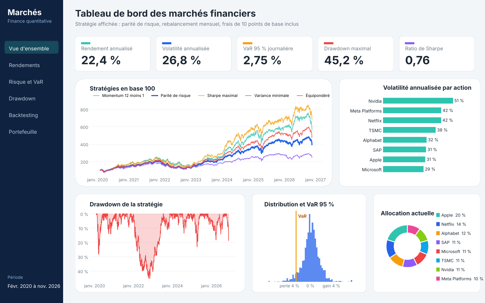

# Finance quantitative et tableau de bord des marchés

Analyse de risque, backtesting et optimisation de portefeuille sur huit grandes valeurs technologiques (Apple, Microsoft, Nvidia, Alphabet, Meta, SAP, TSMC, Netflix), avec une base SQL en schéma en étoile et un tableau de bord.

**Question :** quelle méthode de construction de portefeuille donne le meilleur compromis rendement et risque, une fois testée honnêtement, hors échantillon et avec des frais ?



## Résultats du backtest (février 2020 à novembre 2026)

Rebalancement mensuel, poids calculés uniquement avec les 252 séances précédentes, frais de 10 points de base par rebalancement.

| Stratégie | Rendement annualisé | Volatilité | Sharpe | Drawdown max | VaR 95 % journalière |
|:---|---:|---:|---:|---:|---:|
| Sharpe maximal | 32,8 % | 32,4 % | 0,95 | 45,4 % | 3,2 % |
| Momentum 12 moins 1 mois | 28,9 % | 31,7 % | 0,85 | 46,1 % | 3,1 % |
| Équipondéré | 25,9 % | 28,2 % | 0,85 | 46,8 % | 2,8 % |
| Parité de risque | 22,4 % | 26,8 % | 0,76 | 45,2 % | 2,8 % |
| Variance minimale | 14,3 % | 25,0 % | 0,49 | 42,1 % | 2,4 % |

Ce qu'il faut retenir :
* Le Sharpe maximal a le meilleur ratio de Sharpe hors échantillon, porté par les semiconducteurs en 2023 et 2024, mais c'est la stratégie la plus volatile.
* Le portefeuille équipondéré fait presque jeu égal avec le momentum : une règle très simple reste une référence difficile à battre.
* La variance minimale réduit le risque mais rate une grande partie de la hausse.
* En 2022, toutes les méthodes perdent plus de 30 % : dans un univers aussi corrélé, l'optimisation ne remplace pas la diversification entre classes d'actifs.

## Ce que contient le projet

**Mesures de risque** (`src/quant.py`) : rendement et volatilité annualisés, ratios de Sharpe et de Sortino, drawdown, VaR historique, VaR gaussienne et CVaR (expected shortfall).

**Validation de la VaR** : backtest de la VaR historique glissante avec le test de Kupiec. Elle est dépassée 6,1 % des jours au lieu de 5 % (p valeur de 0,05) : elle sous estime légèrement le risque juste après les chocs.

**Optimisation de portefeuille** : variance minimale, Sharpe maximal et parité de risque (SciPy, poids plafonnés à 35 %), frontière efficiente par simulation.

**Backtesting** : moteur de backtest hors échantillon avec dérive des poids entre deux rebalancements et frais de transaction, appliqué à cinq stratégies dont un momentum 12 moins 1 mois.

**Base SQL** (`sql/schema.sql`) : schéma en étoile SQLite avec deux dimensions (`dim_actif`, `dim_date`) et trois tables de faits (`fait_prix`, `fait_portefeuille`, `fait_poids`). Exemples de requêtes dans `sql/analyses.sql` : performance annuelle, volatilité par secteur, pires journées, meilleure stratégie de chaque mois avec une fonction de fenêtre.

**Tableau de bord** : `src/dashboard.py` génère la vue ci dessus et une version interactive (`reports/dashboard.html`, Plotly). Les tables sont aussi exportées en CSV dans `powerbi/donnees`, avec les mesures DAX dans `powerbi/mesures.dax` pour reconstruire le rapport dans Power BI Desktop.

## Utilisation

```bash
pip install -r requirements.txt

python src/build_database.py                         # base SQLite et exports pour Power BI
python src/dashboard.py --strategie "Sharpe maximal" # tableau de bord PNG et HTML
pytest                                               # tests unitaires
```

L'analyse complète, avec tous les graphiques : [notebooks/FinanceQuantitative.ipynb](notebooks/FinanceQuantitative.ipynb).

## Structure

```
data/raw/                 cours journaliers (un CSV par action)
data/processed/marches.db base SQLite en schéma en étoile
notebooks/                analyse complète, exécutée
src/quant.py              rendements, risque, optimisation, backtest
src/build_database.py     construction de la base et exports
src/dashboard.py          tableau de bord statique et interactif
sql/                      schéma et requêtes d'analyse
powerbi/                  tables CSV et mesures DAX
reports/                  tableau de bord généré
tests/                    tests unitaires
```

## Données

Cours de clôture journaliers ajustés des divisions d'actions, de janvier 2019 au 20 novembre 2026, issus du dépôt public [Pubmarks/datasets](https://github.com/Pubmarks/datasets). Taux sans risque fixé à 2 % par an pour les ratios de Sharpe et de Sortino.

Ce projet est un exercice d'analyse, pas un conseil en investissement.

## Auteur

Nizar, élève ingénieur en Data Science et IA à CESI.
[LinkedIn](https://www.linkedin.com/in/nizar-outski-549941383/)
